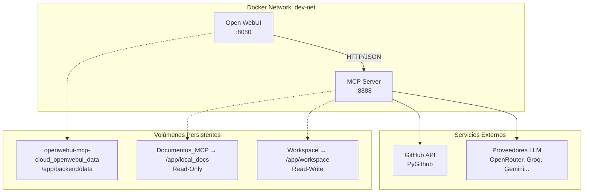
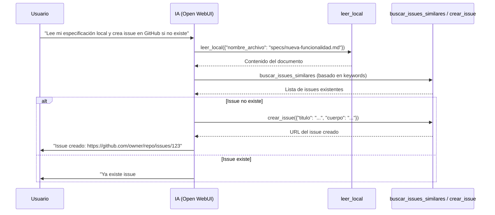

# 🚀 GitHub MCP Server Pro for Open WebUI
[](https://opensource.org/licenses/MIT)
[](https://www.python.org/)
[](https://fastapi.tiangolo.com/)
[](https://www.docker.com/)
[](https://openwebui.com/)

Un servidor de **Model Context Protocol (MCP)** de grado profesional que transforma tu instancia de Open WebUI en un agente autónomo de ingeniería. Permite a la IA navegar repositorios, analizar el historial de desarrollo, procesar documentación técnica compleja y sincronizar datos locales con la nube en tiempo real.

---

## 📋 Tabla de Contenidos
- [🚀 Inicio Rápido](#-inicio-rápido)
- [🏗 Arquitectura del Sistema](#-arquitectura-del-sistema)
- [📦 Instalación y Despliegue](#-instalación-y-despliegue)
- [⚙️ Configuración](#️-configuración)
- [🔧 Herramientas Disponibles](#-herramientas-disponibles)
- [🌉 El Puente de Sincronización (Local → GitHub)](#-el-puente-de-sincronización-local--github)
- [🔒 Seguridad y Diseño](#-seguridad-y-diseño)
- [🐛 Troubleshooting](#-troubleshooting)
- [📁 Estructura del Proyecto](#-estructura-del-proyecto)
- [🤝 Contribuir](#-contribuir)
- [📄 Licencia](#-licencia)

---

## 🚀 Inicio Rápido

### Prerrequisitos
- Docker Desktop + WSL 2 (Windows) / Docker Engine (Linux/Mac)
- Git
- Cuenta GitHub con **Personal Access Token (Classic)** con scopes: `repo`, `read:org`, `read:user`
- (Opcional) API Keys para proveedores LLM: OpenRouter, Groq, Gemini, etc.

### Despliegue en 3 pasos
```bash
# 1. Clonar repositorio
git clone https://github.com/elalmademi/Open-Webui-Github-MCP-Pro.git
cd Open-Webui-Github-MCP-Pro

# 2. Configurar variables de entorno
cp mcp-github-server/.env.example mcp-github-server/.env
# Edita .env con tu GITHUB_TOKEN y otras API keys

# 3. Levantar stack completo
docker compose -f docker-compose.local.yml up -d --build

# Verificar servicios
docker ps --format "table {{.Names}}\t{{.Status}}\t{{.Ports}}"
# Deberías ver: mcp-github-server (healthy, 8888) y open-webui-dev (healthy, 8080)
```

### Acceso a Open WebUI
1. Abre http://localhost:8080
2. Crea tu usuario administrador
3. Ve a **Ajustes → Integraciones → Servidores de herramientas externas**
4. Añade servidor:
   - **Nombre**: `GitHub-MCP-Pro`
   - **URL**: `http://mcp-github-server:8888`
   - **Autorización**: `Ninguna`
5. Activa las herramientas en **Ajustes → Modelos → [Tu modelo] → Herramientas**

---

## 🏗 Arquitectura del Sistema



### Componentes
| Componente | Tecnología | Puerto | Descripción |
|------------|------------|--------|-------------|
| **Interfaz** | Open WebUI | 8080 | UI web para chat, gestión de modelos, herramientas |
| **Servidor MCP** | FastAPI + Uvicorn | 8888 | 11 tools vía HTTP/JSON (POST /tools/*) |
| **Almacenamiento** | Volúmenes Docker | - | Persistencia DB, docs locales, workspace |
| **GitHub** | PyGithub | - | API REST v3/v4 con retry/backoff |
| **LLM Externo** | httpx + OpenAI-compat | - | Multi-proveedor con fallback automático |

---

## 📦 Instalación y Despliegue

### Estructura de Carpetas Requerida
```
Open-Webui-Github-MCP-Pro/
├── docker-compose.local.yml      # Orquestación principal
├── mcp-github-server/
│   ├── Dockerfile                # Imagen Python 3.11-slim
│   ├── main.py                   # Servidor FastAPI v2.5.0
│   ├── requirements.txt          # Dependencias Python
│   └── .env                      # Variables de entorno (crear desde .env.example)
└── .gitignore
```

### Variables de Entorno (.env)
```bash
# GitHub (OBLIGATORIO)
GITHUB_TOKEN=ghp_xxxxxxxxxxxxxxxxxxxx

# Open WebUI
OPENROUTER_API_KEY=sk-or-xxxxxxxxxxxx
# Opcional: otros proveedores
GROQ_API_KEY=gsk_xxxxxxxxxxxx
GEMINI_API_KEY=AIzaSyxxxxxxxxxxxx
# ... etc

# Configuración MCP
CACHE_TTL=86400
REQUEST_TIMEOUT=30
MAX_RETRIES=3
LOG_LEVEL=INFO
```

### Comandos Útiles
```bash
# Ver logs en tiempo real
docker logs -f mcp-github-server
docker logs -f open-webui-dev

# Reiniciar solo MCP
docker compose -f docker-compose.local.yml restart mcp-github-server

# Rebuild completo limpio
docker compose -f docker-compose.local.yml down -v --remove-orphans
docker compose -f docker-compose.local.yml up -d --build

# Backup de base de datos Open WebUI
docker run --rm -v openwebui-mcp-cloud_openwebui_data:/data -v $(pwd):/backup alpine tar czf /backup/openwebui-backup-$(date +%F).tar.gz -C /data .
```

---

## ⚙️ Configuración

### Volúmenes MontaJes
| Montaje | Windows Host | Contenedor | Modo | Propósito |
|---------|--------------|------------|------|-----------|
| `local_docs` | `C:/Users/Alejandro/Documents/IA/Documentos_MCP` | `/app/local_docs` | RO | Documentos para `leer_local` / `listar_archivos_locales` |
| `workspace` | `C:/Users/Alejandro/Documents/IA/Workspace` | `/app/workspace` | RW | Proyecto activo (`venezuela-energy-monitor`), `escribir_archivo_local`, `ejecutar_comando` |
| `openwebui_data` | Volumen Docker externo | `/app/backend/data` | RW | Base de datos SQLite, configuración, modelos |

### Puertos
| Servicio | Puerto Host | Puerto Contenedor | Protocolo |
|----------|-------------|-------------------|-----------|
| Open WebUI | 8080 | 8080 | HTTP |
| MCP Server | 8888 | 8888 | HTTP/JSON |

### Healthchecks
```yaml
# MCP Server
healthcheck:
  test: ["CMD", "curl", "-fsS", "http://localhost:8888/health"]
  interval: 30s
  timeout: 10s
  retries: 3
  start_period: 30s
```

---

## 🔧 Herramientas Disponibles (11 Tools)

Todas las tools exponen **POST /tools/{nombre}** compatible con Open WebUI External Tool Servers.

### 📁 Archivos Locales
| Tool | Endpoint | Parámetros | Descripción |
|------|----------|------------|-------------|
| `listar_archivos_locales` | `/tools/listar_archivos_locales` | `{}` | Lista recursiva archivos en `/app/local_docs` con metadata (tamaño, fecha, extensión) |
| `leer_local` | `/tools/leer_local` | `{"nombre_archivo": "string"}` | Lee PDF (PyPDF2), DOCX (python-docx), TXT/MD (UTF-8). Path traversal protection. |
| `escribir_archivo_local` | `/tools/escribir_archivo_local` | `{"ruta": "string", "contenido": "string"}` | Escribe en `/app/workspace` (RW). Crea directorios padres. |

### 🐙 GitHub
| Tool | Endpoint | Parámetros | Descripción |
|------|----------|------------|-------------|
| `buscar_repo` | `/tools/buscar_repo` | `{"query": "string"}` | Busca repos en GitHub (top 5). Retorna nombre, estrellas, URL, lenguaje. |
| `mapear_repositorio` | `/tools/mapear_repositorio` | `{"repo": "owner/repo", "ruta": "string?"}` | Árbol de directorios/archivos con iconos 📁/📄. |
| `leer_archivo` | `/tools/leer_archivo` | `{"repo": "owner/repo", "ruta": "string"}` | Contenido completo archivo (decodificado UTF-8). |
| `listar_issues` | `/tools/listar_issues` | `{"repo": "owner/repo", "estado": "open\|closed\|all", "limite": "int"}` | Issues con número, título, estado, URL. |
| `crear_issue` | `/tools/crear_issue` | `{"repo": "owner/repo", "titulo": "string", "cuerpo": "string"}` | Crea issue, retorna URL. |
| `buscar_codigo` | `/tools/buscar_codigo` | `{"query": "string"}` | GitHub Code Search (top 10). Retorna archivo, repo, URL. |
| `analizar_historial_commits` | `/tools/analizar_historial_commits` | `{"repo": "owner/repo", "limite": "int"}` | Últimos commits con mensaje, autor, fecha, hash. |

### 🤖 LLM / Sistema
| Tool | Endpoint | Parámetros | Descripción |
|------|----------|------------|-------------|
| `buscar_modelo_gratis` | `/tools/buscar_modelo_gratis` | `{"criterio": "string"}` | Recomienda proveedor/modelo gratis según criterio: "rápido", "contexto largo", "código", "fallback", "privado". |
| `consultar_llm_externo` | `/tools/consultar_llm_externo` | `{"provider_id": "string?", "model_id": "string?", "prompt": "string", "temperatura": "float", "max_tokens": "int", "system_prompt": "string?"}` | Multi-proveedor con fallback automático. Retorna respuesta + proveedor usado. |
| `verificar_sistema` | `/tools/verificar_sistema` | `{}` | Health check: GitHub conectado, providers configurados, volúmenes montados. |
| `ejecutar_comando` | `/tools/ejecutar_comando` | `{"comando": "string", "timeout": "int?"}` | Shell en `/app/workspace` (60s default). Para debugging. |

---

## 🌉 El Puente de Sincronización (Local → GitHub)

Flujo típico de trabajo agente-humano:



**Casos de uso:**
- 📄 Especificaciones técnicas → Issues de GitHub
- 🐛 Reportes de bugs locales → Tracking en GitHub
- 📝 Notas de reunión → Documentación en repo
- 🔄 Sincronización bidireccional de conocimiento

---

## 🔒 Seguridad y Diseño

### Aislamiento de Datos
- **`local_docs` montado `:ro`** — La IA solo lee, nunca escribe en tus documentos personales.
- **`workspace` montado `:rw`** — Zona de trabajo controlada (`/app/workspace`), aislada del sistema host.
- **Path Traversal Protection** — `Path.resolve()` + `startswith(base)` en todas las tools de archivos.

### Protección de API
- **Rate Limiting GitHub** — Retry automático con backoff exponencial + respeto a headers `X-RateLimit-Reset`, `Retry-After`.
- **Timeouts configurables** — `REQUEST_TIMEOUT=30s`, `MAX_RETRIES=3`.
- **Tokens en variables de entorno** — Nunca en código ni logs.

### Healthcheck & Auto-recovery
- **MCP Server**: Healthcheck cada 30s, auto-restart en fallo.
- **Open WebUI**: Healthcheck nativo + migraciones Alembic automáticas al arranque.
- **Docker restart policy**: `unless-stopped` en ambos servicios.

---

## 🐛 Troubleshooting

| Síntoma | Causa Probable | Solución |
|---------|----------------|----------|
| `404 Not Found` en tools | URL incorrecta en Open WebUI | Usar `http://mcp-github-server:8888` (sin `/sse`, sin trailing slash) |
| `422 Validation Error` | JSON malformado desde PowerShell | Usar `docker cp` + `@/tmp/json.json` o editar `main.py` directamente |
| `500 Internal Server` en `leer_local` | Falta `python-docx` / `PyPDF2` | Verificar `requirements.txt` y rebuild |
| `GitHub 403/429` | Rate limit o token inválido | Verificar `GITHUB_TOKEN` en `.env`, scopes `repo` |
| Puerto 8888 no accesible | Dockerfile EXPOSE ≠ main.py port | Verificar `EXPOSE 8888` + `uvicorn.run(port=8888)` + compose `8888:8888` |
| Contenedor `Restarting` | SyntaxError en `main.py` | Revisar `docker logs mcp-github-server` |
| Open WebUI no ve tools | Servidor no registrado o URL wrong | Admin → Settings → External Tool Servers → verificar URL |

### Logs Útiles
```bash
# MCP Server
docker logs mcp-github-server --tail 50

# Open WebUI (migraciones, startup)
docker logs open-webui-dev --tail 50

# Test conectividad red interna
docker exec open-webui-dev curl -fsS http://mcp-github-server:8888/health
docker exec open-webui-dev curl -fsS http://mcp-github-server:8888/openapi.json
```

---

## 📁 Estructura del Proyecto

```
Open-Webui-Github-MCP-Pro/
├── docker-compose.local.yml          # Orquestación: 2 servicios, red dev-net, volúmenes
├── .gitignore                        # Excluye backups, .env, __pycache__, volúmenes
├── README.md                         # Este archivo
├── mcp-github-server/
│   ├── Dockerfile                    # python:3.11-slim + build-essential + libxml2
│   ├── main.py                       # FastAPI v2.5.0 - 11 tools, Pydantic v2, lifespan
│   ├── requirements.txt              # PyGithub, fastapi, uvicorn, pydantic>=2, httpx, docx, pdf
│   ├── .env.example                  # Template de variables de entorno
│   └── .gitignore                    # Excluye .env, backups, logs
└── backup-scripts/
    └── BACKUP_COMPLETO_Y_PUSH_GITHUB.ps1  # Script backup local + push GitHub
```

---

## 🤝 Contribuir

1. Fork del repositorio
2. Crea rama feature: `git checkout -b feature/nueva-tool`
3. Commit convencional: `git commit -m "feat: agregar tool xyz"`
4. Push y Pull Request

### Estándares de Código
- **Python**: Black + Ruff (lint)
- **Commits**: Conventional Commits (`feat:`, `fix:`, `docs:`, `refactor:`)
- **Tests**: Añadir en `tests/` (pytest)

---

## 📄 Licencia

**MIT License** — Libre para uso personal, comercial, modificación y distribución.

Ver [LICENSE](LICENSE) para detalles.

---

## 🙏 Agradecimientos

- [Open WebUI](https://github.com/open-webui/open-webui) — Interfaz excepcional
- [FastAPI](https://fastapi.tiangolo.com/) — Framework moderno y rápido
- [PyGithub](https://pygithub.readthedocs.io/) — Cliente GitHub robusto
- [Awesome Free LLM APIs](https://github.com/mnfst/awesome-free-llm-apis) — Catálogo de proveedores gratuitos
- Comunidad MCP — Protocolo abierto para herramientas de IA

---

**¿Problemas? ¿Ideas?** → [Abrir Issue](https://github.com/elalmademi/Open-Webui-Github-MCP-Pro/issues) · [Discusiones](https://github.com/elalmademi/Open-Webui-Github-MCP-Pro/discussions)

---

## 📤 Publicar en GitHub

Ejecuta en tu PowerShell (Admin):

```powershell
cd C:\openwebui-mcp-cloud\github-mcp-pro

# 1. Sobrescribir README.md con este contenido expandido
# (Copia el markdown de arriba y pégalo en README.md con tu editor)

# 2. Commit y push
git add README.md
git commit -m "docs: expandir README con arquitectura, config, tools detalladas, troubleshooting, sincronización local-GitHub"
git push origin main
```

### Verificación en GitHub
1. Ve a **https://github.com/elalmademi/Open-Webui-Github-MCP-Pro**
2. Verifica que el README se renderice correctamente (tablas, mermaid, badges)
3. Confirma que los enlaces internos funcionan

---

**¡Listo! Tu documentación ahora refleja todo el trabajo real implementado.**